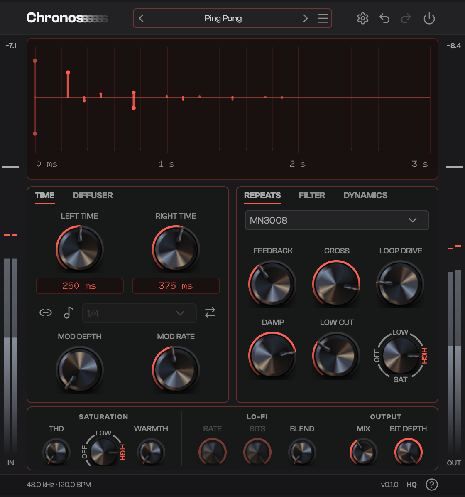

<h1 align="center">Chronos</h1>

<b>Nonlinear Delay Engine</b> by <a href="https://lissajouslabs.com">Lissajous Labs</a>

  

  <a href="https://lissajouslabs.com/chronos#download"><b>Download</b></a> ·
  <a href="../../releases">All releases</a> ·
  <a href="https://lissajouslabs.com/faq">FAQ</a> ·
  <a href="SUPPORT.md">Support</a>

A stereo delay with Digital, MN3005 and MN3008 delay cores and a saturating
feedback loop. Free beta for macOS, Windows and Linux.

This repository holds release builds only; the source is private.

## Formats

| Platform | File | Contains |
|---|---|---|
| macOS 11+ (universal) | `Chronos-<version>-macOS.dmg` | VST3, AU, Standalone |
| Windows 10+ (x64) | `Chronos-<version>-Windows.zip` | VST3, Standalone |
| Linux (x64) | `Chronos-<version>-Linux.zip` | VST3, Standalone |

## Installing

**macOS.** Open the DMG and drag each item onto the folder link beside it:
`Chronos.vst3` to *VST3 Plug-Ins*, `Chronos.component` to *AU Plug-Ins
(Components)* and `Chronos.app` to *Applications*. The beta isn't signed yet:
the DMG's `Install.txt` and the [FAQ](https://lissajouslabs.com/faq#unsigned)
have the one-line command that lets macOS open it.

**Windows.** Copy `Chronos.vst3` to `C:\Program Files\Common Files\VST3`.
`Chronos.exe` is the standalone app.

**Linux.** Copy `Chronos.vst3` to `~/.vst3`. `Chronos` is the standalone app.

Rescan plug-ins in your DAW afterwards.

## Help

- Install questions and the unsigned beta: the [FAQ](https://lissajouslabs.com/faq).
- Bugs: [open an issue](../../issues/new/choose).
- Anything else: [SUPPORT.md](SUPPORT.md). Security problems: [SECURITY.md](SECURITY.md).

The beta is free to use under the [Lissajous Labs terms](https://lissajouslabs.com/terms).
